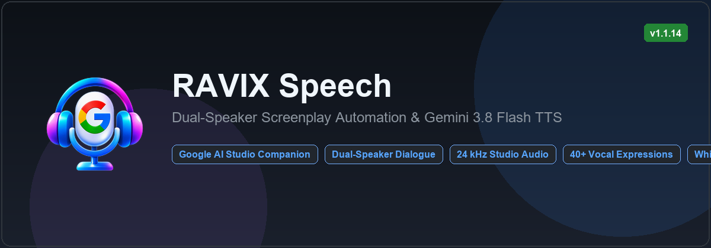
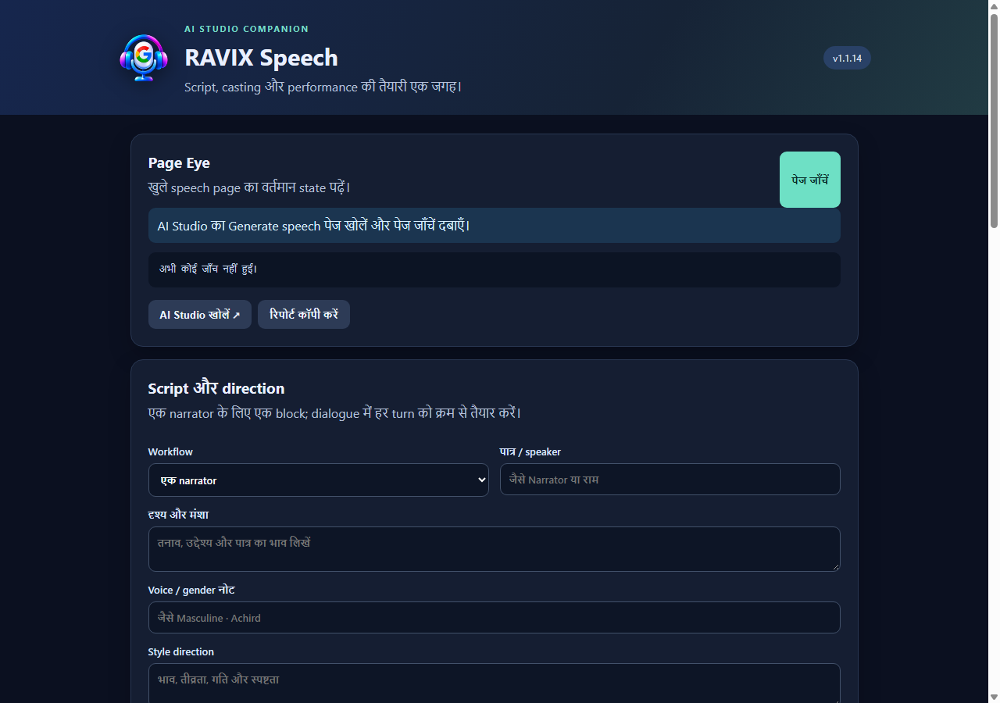
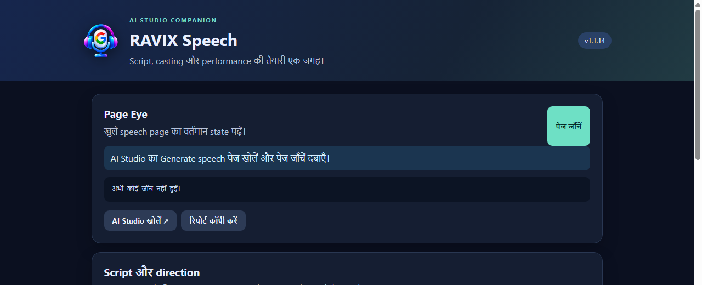
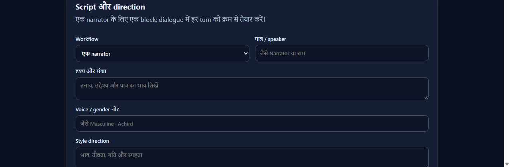

<p align="center">
  
</p>

<p align="center">
  
  
  
  
  
</p>

---

# RAVIX Speech

**RAVIX Speech** is an autonomous companion and browser automation bridge for **Google AI Studio's Speech Generation** (`gemini-3.8-flash-tts`). It empowers creators, AI agents, and video editors to automate complex dual-speaker screenplays, orchestrate voice design, apply line-by-line performance directions, and extract verified 24 kHz studio audio masters ready for WhisperX word-alignment and video pipelines.

---

## 📸 Screenshots

| RAVIX Speech Workspace Panel | Live Page Eye & State Inspector |
| :---: | :---: |
|  |  |

<p align="center">
  <b>Multi-Speaker Screenplay & Dialogue Batch Planner</b><br>
  
</p>

---

## ✨ Features

- 🎭 **Dual-Speaker Screenplay Automation**: Organize multi-character dialogue scenes (e.g. Ram vs. Ravana) with persistent speaker casting, line-by-line vocal tone, and seamless multi-block generation.
- 👁️ **Page Eye (Live DOM Inspector)**: Privacy-conscious, real-time snapshot of the active Google AI Studio tab (detects active speech blocks, speaker voice tags, model status, and download readiness).
- 🎙️ **40+ Vocal Expression Tags**: Native insertion for micro-expressions (`<breath>`, `<short pause>`, `<sigh>`, `<cough>`, `<gasp>`, `<laughter>`) and custom delivery styling (pace, emotion, whisper, loudness).
- 🔌 **Local Automation Bridge (`port 17842`)**: Built-in HTTP / WebSocket bridge allowing external AI agents (Antigravity, Codex) and Python CLI tools to orchestrate speech generation headlessly.
- 📦 **Studio-Grade 24 kHz WAV Extraction**: Automatically verifies and captures clean 24 kHz mono 16-bit PCM master WAV files for audio mixing and WhisperX forced alignment.
- 🛡️ **Zero API Key Leakage**: Directly utilizes your active, signed-in Google AI Studio session in the browser with full privacy.

---

## 🚀 Quick Start & Installation

### 1. Install Extension in Brave / Chrome
1. Clone or download this repository:
   ```bash
   git clone https://github.com/ranjanvish/ravix-speech.git
   ```
2. Open your Chromium browser (`brave://extensions` or `chrome://extensions`).
3. Enable **Developer mode** in the top-right corner.
4. Click **Load unpacked** and select the cloned `ravix-speech` repository folder.
5. Pin the **RAVIX Speech** extension to your browser toolbar.

### 2. Connect to Google AI Studio
1. Open [Google AI Studio Speech Generation](https://aistudio.google.com/generate-speech) in your browser.
2. Click the **RAVIX Speech** icon on your toolbar to open the companion workspace.
3. Click **पेज जाँचें (Check Page)** to verify that Page Eye detects the active studio session.

---

## 💻 CLI & Autonomous Pipeline

### Run Local Bridge Server
Start the local loopback bridge server:
```bash
python bridge/server.py
```
*The bridge will listen on `http://127.0.0.1:17842` for agent commands (`status`, `scan`, `enqueue`, `job`, `get_audio`).*

### CLI Speech Generation
Generate dialogue from a script file directly:
```bash
python scripts/run_speech.py --script "scripts/ram-ravan-script.txt" --output "output.wav"
```

### WhisperX Forced Alignment
Align generated audio with millisecond word timestamps:
```bash
python scripts/run_alignment.py --audio "output.wav"
```

---

## 📁 Repository Structure

```
ravix-speech/
├── assets/                          # Badges, screenshots and promotional banners
│   ├── banner.png
│   ├── screenshot-panel.png
│   ├── screenshot-page-eye.png
│   └── screenshot-dialogue-planner.png
├── bridge/                          # Local Python automation bridge (Port 17842)
│   ├── server.py
│   ├── run_project.py
│   └── rama-ravana-project.json
├── docs/                            # In-depth production & performance guides
│   ├── INSTANT-RUNBOOK.md
│   ├── performance-direction-guide.md
│   ├── SAFETY-AND-DIALOGUE.md
│   ├── speech-interface-map.md
│   └── speech-production-guide.md
├── icons/                           # Extension brand assets & logo masters
├── scripts/                         # CLI runners & screenplay samples
│   ├── run_speech.py
│   ├── run_alignment.py
│   └── ram-ravan-script.txt
├── automation.js                    # Core script injector & studio automation
├── background.js                    # Service worker & message router
├── content.js                       # Content script for AI Studio DOM interaction
├── dialogue-planner.js              # Multi-character dialogue project batch planner
├── manifest.json                    # Chrome Extension Manifest V3
├── panel.html                       # Extension companion UI
├── panel.js                         # Companion workspace logic
├── panel.css                        # Modern dark-mode styling
├── release.py                       # Version bumper & ZIP packager
└── README.md
```

---

## 📜 License

Distributed under the MIT License. See `LICENSE` for more information.

---

<p align="center">
  Crafted with ❤️ by <b>Ranjan Vishwakarma</b> | Part of the <b>RAVIX Ecosystem</b>
</p>
